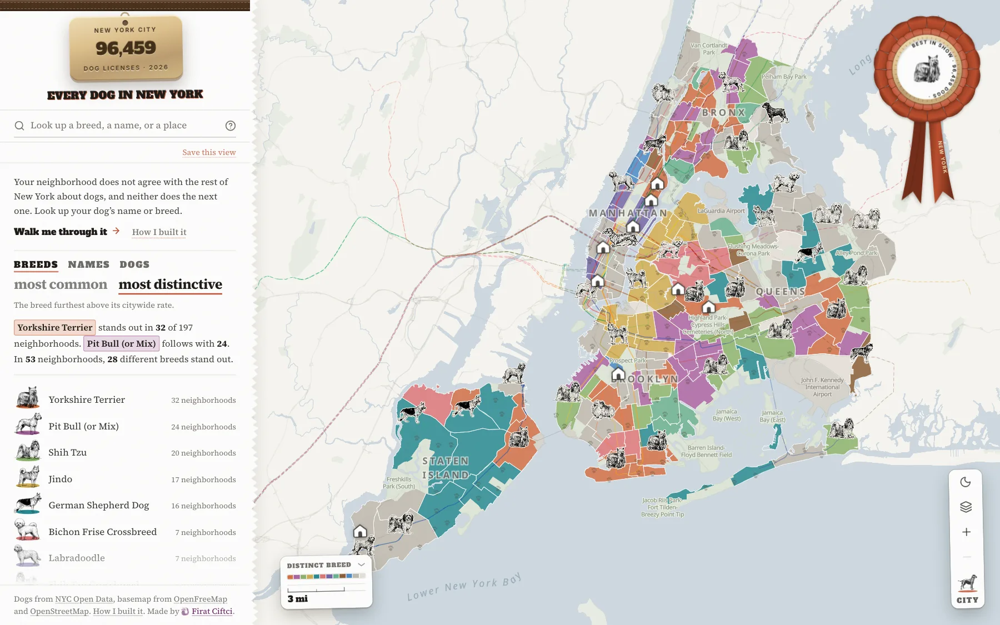
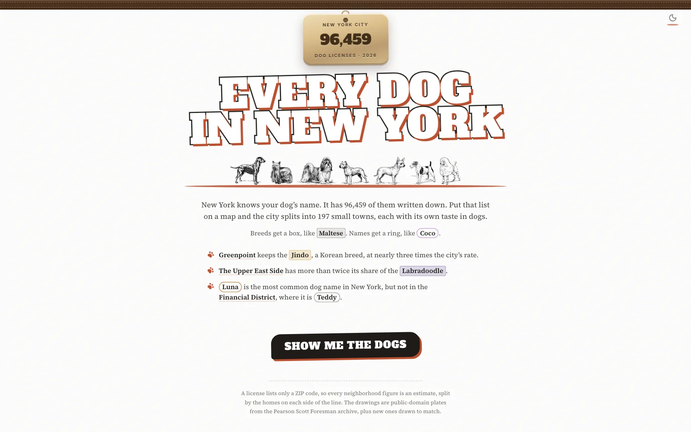
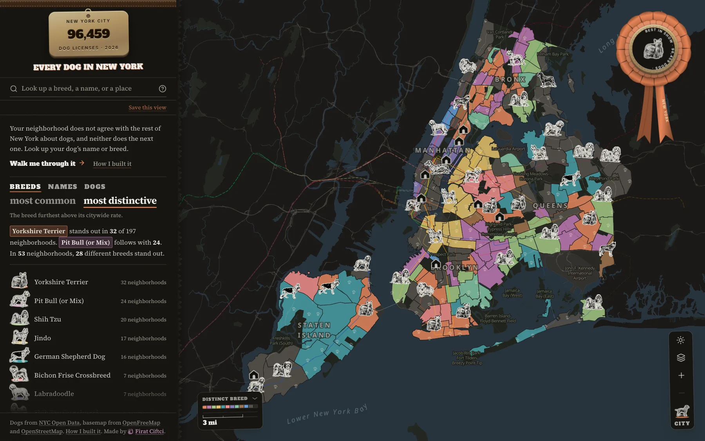
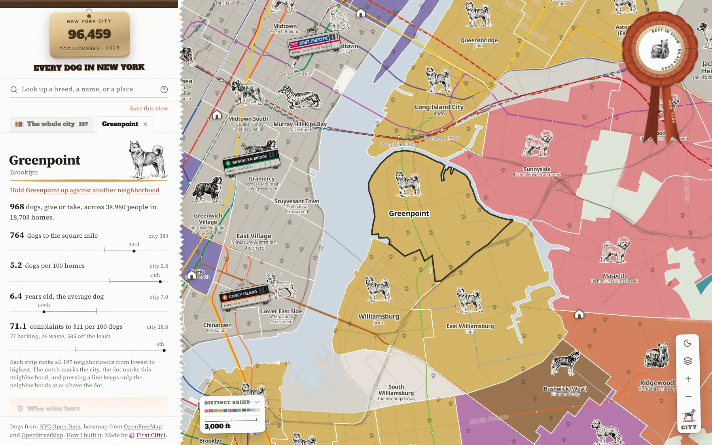
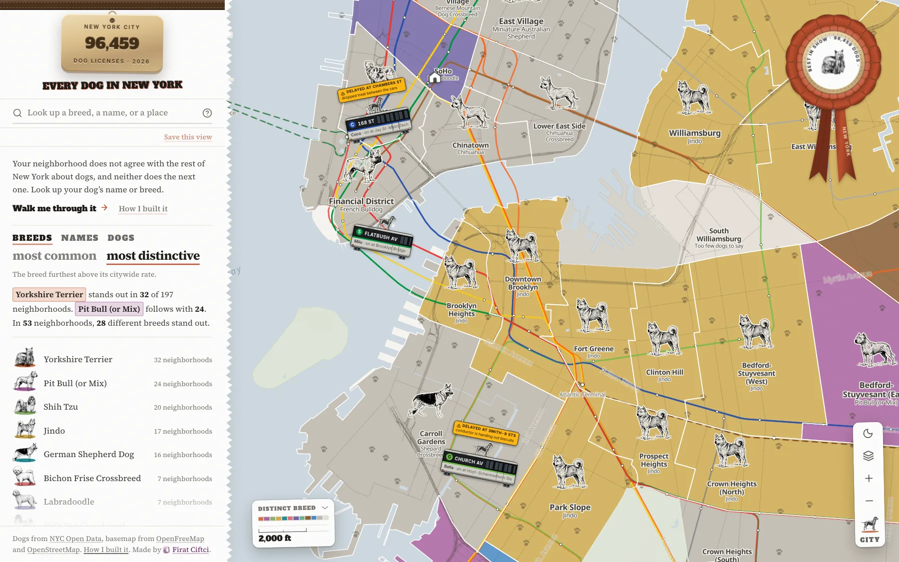
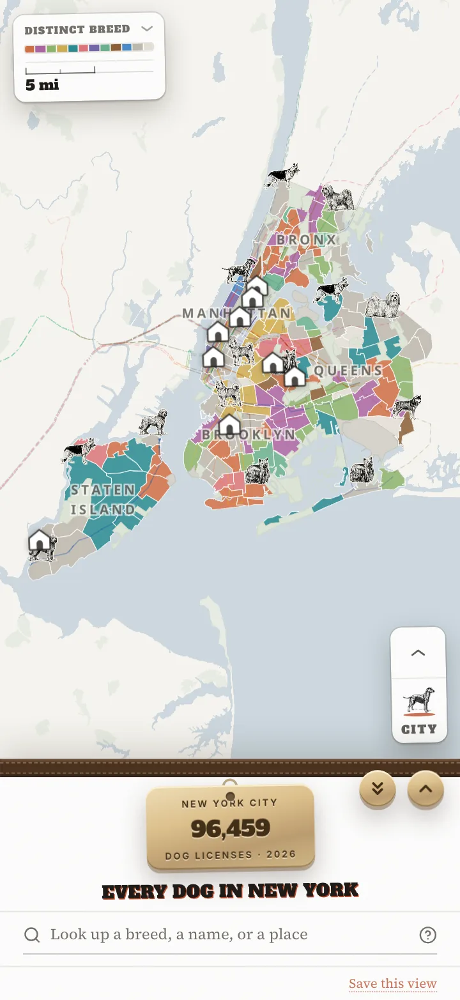
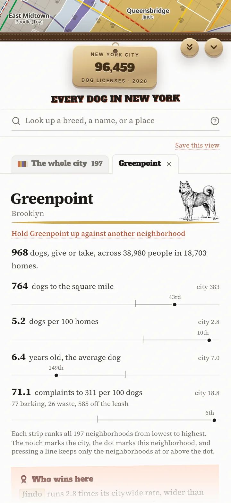

<p align="center">
  <a href="https://everydog.nyc">
    <picture>
      <source media="(prefers-color-scheme: dark)" srcset="docs/screenshots/title-dark.png">
      
    </picture>
  </a>
</p>

<p align="center">

[](https://everydog.nyc)
[](LICENSE)
[](https://svelte.dev)
[](https://maplibre.org)
[](https://data.cityofnewyork.us/Health/NYC-Dog-Licensing-Dataset/nu7n-tubp)

</p>

96,459 licensed dogs mapped across 197 New York City neighborhoods, against the people and homes in each. Live at **[everydog.nyc](https://everydog.nyc)**.

[](https://everydog.nyc)

New York City publishes its dog license file every year. Each record lists a dog's name, breed, and birth year, along with the owner's ZIP code. This site places the 2026 file in the city's 2020 neighborhoods, which come with census population and household counts, so the map can show dogs per home as well as raw totals. It is a static site with no server, rebuilt from public data by a handful of Python scripts.

By count, Labrador leads 75 of the 197 neighborhoods, and only nine breeds lead any. Ranked by how far a breed runs above its citywide rate, 38 breeds lead somewhere. Greenpoint keeps Jindos at nearly three times the city's rate, and the Upper East Side has more than twice its share of Labradoodles. Luna is the most common name in the city, but in the Financial District it is Teddy.

## What is on the map

- **Ten layers.** Most common and most distinctive breed, most common and most distinctive name, total dogs, dogs per square mile, dogs per 100 homes, dogs per 1,000 people, 311 complaints per 100 dogs, and any single breed or name as a rate per 1,000 dogs.
- **Neighborhood panels.** Each breed and name row shows its count and how far it runs above or below the citywide rate, and the list sorts either way. Each panel also lists the ZIP codes behind its numbers.
- **Clickable numbers.** Pressing a figure filters the map to the neighborhoods at or above it. Pressing a breed or name colors the map by it.
- **Search.** Look up a breed, a name, or a place, narrow to a borough or a range of dogs, or compare up to four breeds, names, or places.
- **311 complaints.** Twelve months of complaints about barking, dog waste, and off-leash dogs, placed by their coordinates and divided by estimated licensed dogs. Manhattan is lowest at 11.4 per 100 dogs, and the Bronx is highest at 32.8.
- **Shelters.** The nine shelters in the city you can walk into, with addresses taken from each organization's own site.
- **Trains.** Past zoom 12.6, dogs ride the subway, the Long Island Rail Road, Metro-North, PATH, New Jersey Transit, and Amtrak on their real routes. Click a train to follow it.
- **Park games.** Central Park and Prospect Park each have a short game that runs on a real off-leash clock.
- **Light and dark modes**, a phone layout with a draggable sheet, and reduced-motion support.

## Screenshots

|                                                                 |                                                         |
| --------------------------------------------------------------- | ------------------------------------------------------- |
|                 |  |
|  |  |

<p align="center">
  
  &nbsp;&nbsp;
  
</p>

## Read this before quoting a number

A license lists a ZIP code and nothing finer, so every neighborhood figure is an estimate. Each ZIP's dogs are split across the neighborhoods it touches in proportion to residential units from PLUTO, then weighted by a fitted estimate of how likely a home in each neighborhood is to have a dog.

Matching dogs across the city's yearly files shows that the current file holds about half the dogs that pass through licensing. [docs/method.md](docs/method.md) covers the whole method.

## The data

| Source                                                                                                                                 | What we take                                         |
| -------------------------------------------------------------------------------------------------------------------------------------- | ---------------------------------------------------- |
| [NYC Dog Licensing Dataset](https://data.cityofnewyork.us/Health/NYC-Dog-Licensing-Dataset/nu7n-tubp)                                  | 96,459 licenses in the 2026 file                     |
| [2020 Neighborhood Tabulation Areas](https://data.cityofnewyork.us/City-Government/2020-Neighborhood-Tabulation-Areas-NTAs-/9nt8-h7nd) | 197 residential areas, 65 that are not               |
| [2020 Census by NTA](https://www.nyc.gov/content/planning/pages/resources/datasets/decennial-census) (DCP)                             | 8,796,527 people in 3,369,743 homes                  |
| [PLUTO](https://data.cityofnewyork.us/City-Government/Primary-Land-Use-Tax-Lot-Output-PLUTO-/64uk-42ks)                                | 767,137 residential lots, used to split ZIP counts   |
| [Borough Boundaries](https://data.cityofnewyork.us/City-Government/Borough-Boundaries/gthc-hcne)                                       | shoreline clip                                       |
| [311 Service Requests](https://data.cityofnewyork.us/Social-Services/311-Service-Requests-from-2010-to-Present/erm2-nwe9)              | 18,609 dog complaints, September 2025 to August 2026 |
| [OpenStreetMap](https://www.openstreetmap.org/copyright)                                                                               | PATH, NJ Transit, and Amtrak routes and stops, ODbL  |
| [OpenFreeMap](https://openfreemap.org)                                                                                                 | basemap tiles, no key, no rate limit                 |

Three of the pipeline's outputs are published as downloads: [summary.json](https://everydog.nyc/data/summary.json), [matrix.json](https://everydog.nyc/data/matrix.json) (estimated dogs by neighborhood, breed, and name), and [details.json](https://everydog.nyc/data/details.json) (each neighborhood's ranked lists, with lift over the citywide rate). Their neighborhood figures are the same estimates the map shows.

## How it is built

```
.                          SvelteKit 2 app (Svelte 5, Tailwind 4, MapLibre GL)
  src/lib/                 components, layer logic, map style
  static/data/             the files the app loads, written by the pipeline
  static/breeds/           the breed plates
pipeline/                  Python that builds those files
  step0_neighborhoods.py   2020 NTAs + the census -> the neighborhood file
  build_data.py            licenses + PLUTO crosswalk + 311 -> per-neighborhood tallies
  build_rail.py            subway, LIRR, Metro-North, PATH, NJ Transit, and Amtrak
  build_social.py          the share card, the icons, and the README banners
  fetch_breeds.py          the public-domain breed plates
  draw_breed.py            plates for the breeds the archive never drew
  fetch_photos.py          breed photographs and descriptions from Wikimedia Commons and Wikipedia
  preview_*.py             PNG previews for checking the neighborhood partition
docs/
  method.md                how every number is made
  design.md                the design system
  notes.md                 things that are easy to break and hard to see
```

The app is prerendered to static files and served as Cloudflare Workers static assets, with no Worker code. The build is 14 MB in about 260 files, and the first paint loads 296 KB compressed. The basemap is a stripped [OpenFreeMap](https://openfreemap.org) style with the choropleth drawn under the roads, so the street grid stays legible over the color.

## Running it

```
pnpm install
pnpm dev            # http://localhost:3010
pnpm ci             # check, format, lint, and test
```

Rebuilding the data needs Python and `nlx` on PATH. Each script downloads its own inputs into `pipeline/data/` on first run. The city publishes the license file once a year, so this is a yearly job.

```
cd pipeline
uv sync
.venv/bin/python step0_neighborhoods.py   # ~90s, writes out/nyc_neighborhoods.geojson
.venv/bin/python build_data.py            # writes ../static/data/*
.venv/bin/python build_rail.py            # writes ../static/data/rail.topo.json
.venv/bin/ruff format . && .venv/bin/ruff check . && .venv/bin/ty check .
```

Run `build_data.py` after step 0. It reads the neighborhood file step 0 writes and imports step 0's `read_census` for the household columns the split is fitted on. `build_rail.py` only needs `out/_nyc_land.geojson`, which step 0 also writes.

`build_social.py` draws the share card, the icons from `static/favicon.svg`, and the two banners at the top of this README, taking every number from `summary.json`, so run it after `build_data.py`. It needs `rsvg-convert`, `magick`, and Chrome on PATH, because the card's title uses `-webkit-text-stroke` and a `text-shadow` that no SVG rasterizer supports.

```
.venv/bin/python build_social.py           # writes ../static/og.png and the icons
.venv/bin/python build_social.py card      # or just the card
.venv/bin/python build_social.py banner    # or just the README banners
```

`draw_breed.py` calls Gemini 3 Pro Image and needs `GEMINI_API_KEY` in `pipeline/.env`. It is only needed when the city's file names a breed the archive has no plate for.

## Deploying

`adapter-static` prerenders everything into `build/`, and `wrangler.jsonc` ships that folder as a Cloudflare Worker made only of static assets, which the Workers free plan serves without limits.

Cloudflare Workers Builds deploys every push to `main` and gives every other branch a preview URL. The build command is `pnpm run ci && pnpm run build`, the deploy command is `npx wrangler deploy`, and the output directory stays blank because `wrangler.jsonc` sets it. To deploy from a laptop, run `pnpm exec wrangler login` once, then `pnpm run deploy`.

`static/_headers` sets immutable caching on hashed assets, an hour on the data files, and a day on the icons and the share card, plus HSTS, `nosniff`, and a referrer policy everywhere. Node is pinned to 24 in `.nvmrc`.

## Design

The design takes its rules from the CSS The Pudding ships. Everything on the page is one of two materials, stamped metal or ink on paper. The masthead is a brass license tag on a leather strap, which on a phone doubles as the handle of the bottom sheet. The breed drawings are plates from the Pearson Scott Foresman archive, line art the educational publisher donated to Wikimedia Commons in 2007 and released into the public domain, and the breeds the archive never drew were drawn to match, using six of the originals as reference. [docs/design.md](docs/design.md) has the full rules.

## Contributing

Issues and pull requests are welcome, especially from someone who knows a block and thinks its number looks wrong. [CONTRIBUTING.md](CONTRIBUTING.md) covers reporting, setup, and the checks. The project follows the [Contributor Covenant](CODE_OF_CONDUCT.md).

## Credits and license

The code is released under the [MIT License](LICENSE). The dog license file, boundaries, PLUTO, and census tables come from NYC Open Data or the Department of City Planning. The basemap is OpenFreeMap, which serves tiles rendered from OpenStreetMap data.

Two files carry their own terms. The PATH, New Jersey Transit, and Amtrak geometry in `static/data/rail.topo.json` comes from OpenStreetMap route relations, so that file is released under [ODbL 1.0](https://opendatacommons.org/licenses/odbl/1-0/), credited to OpenStreetMap contributors. The breed descriptions in `static/data/breed-photos.json` are opening lines of English Wikipedia articles and carry CC BY-SA 4.0. Wikimedia photographs are credited in place with their own licenses, and the archive plates are public domain.

Built by [Firat Ciftci](https://www.firatciftci.com) in Brooklyn.
